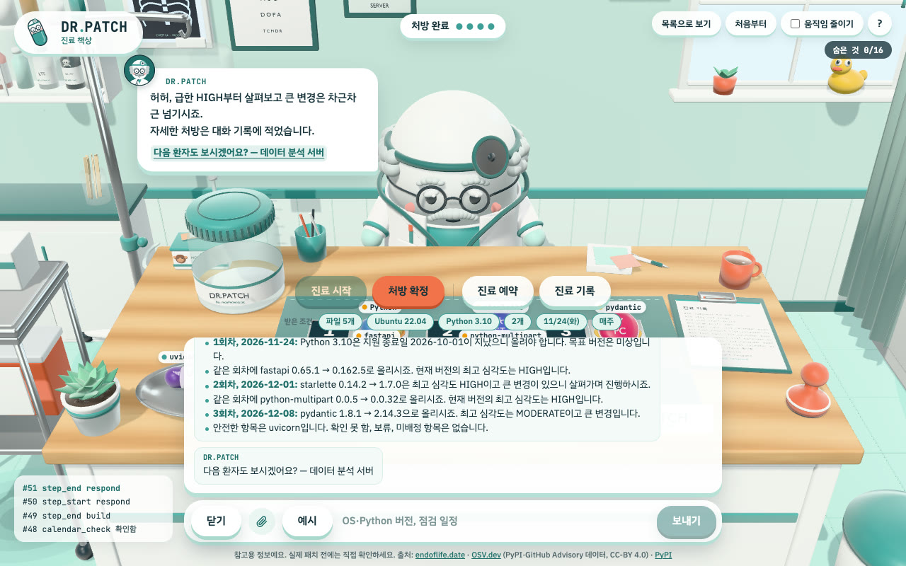
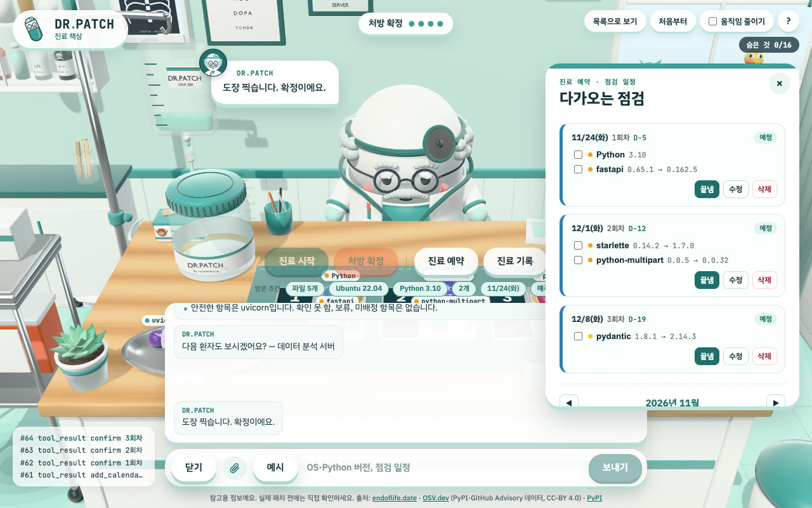
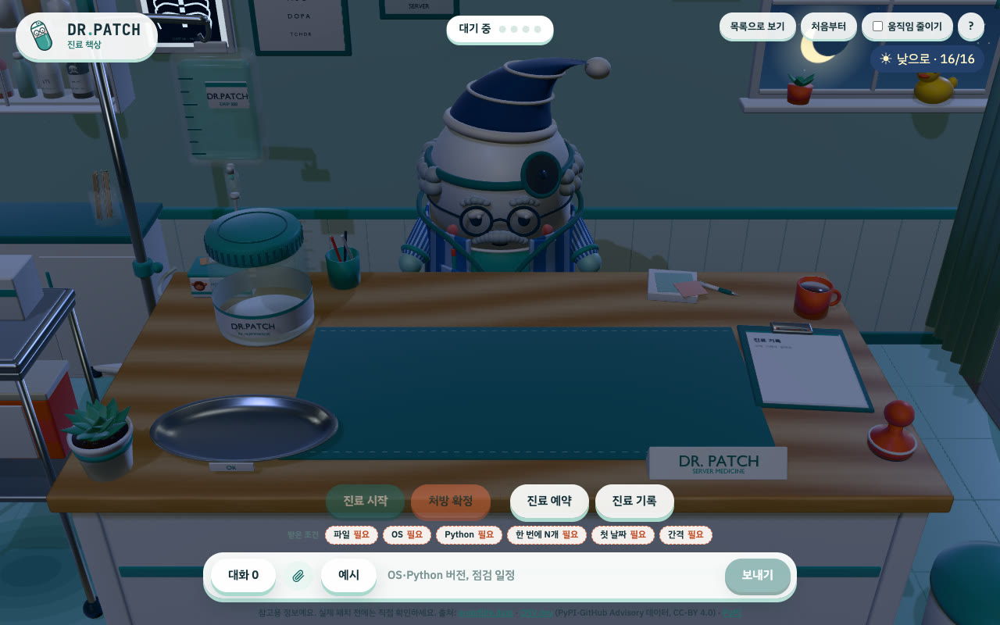
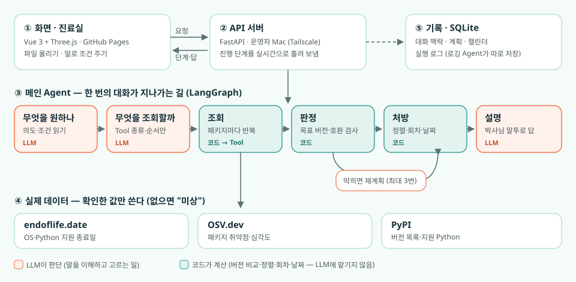

# DR.PATCH — 서버 패치·EOL 점검 플래너

> Upload a `pip freeze`, tell the doctor your OS and Python, and get a round-by-round patch plan built from real EOL, vulnerability and release data.

DR.PATCH(저장소 이름 sudo-patch)는 `pip freeze`로 만든 requirements.txt와 OS·Python 버전을 받아 **회차별 패치 계획**을 세우는 Agent 서비스입니다. 진료실처럼 생긴 3D 화면에서 박사님이 패키지(알약)를 검사하고, 위험한 것부터 블리스터(회차)에 담아 처방합니다. 지원 종료일·취약점·버전은 **실제 API(endoflife.date · OSV.dev · PyPI)로 조회한 값만** 씁니다. 확인하지 못한 값은 지어내지 않고 "미상" / "확인 못 함"으로 둡니다.


**▶️ 바로 써 보기: https://ho0829-ui.github.io/sudo-patch/** — 화면은 GitHub Pages, API는 운영자의 Mac에서 서버가 켜져 있을 때 동작합니다(꺼져 있으면 "서버에 닿지 않네요"). 파일이 없어도 **예시 차트** 10개로 바로 해 볼 수 있습니다. 배포 구성은 [배포 가이드](docs/deploy.md).

## 무엇을 할 수 있나

박사님에게 일상어로 말하면 됩니다: *"Ubuntu 22.04, Python 3.10, 한 번에 2개, 다음 주 화요일부터 매주 화·목"*.

| 하는 일 | 어떻게 |
|---|---|
| **검사** | 패키지마다 OSV.dev 취약점(최고 심각도)·PyPI 버전·`requires_python`, OS·Python 지원 종료일을 조회합니다. 조회 결과는 약병 위 이름표로 떠오릅니다. |
| **판정** | 목표 버전은 "취약점이 없고 지금 Python에서 설치되는 가장 새 버전". 막히면 **재계획** — Python을 먼저 올리는 계획과 보류 중 LLM이 고르고, 계산은 코드가 합니다. |
| **처방** | 심각도 → 지원 종료가 빠른 순으로 정렬하고, 한 번에 N개씩 회차로 나눕니다. 안전한 패키지는 곡반으로, 회차에 못 든 것은 약병에 남아 "다음 진료". |
| **일정** | 매주·격주·N일마다·**요일 반복(매주 화·목, 평일)**. "주 2회"처럼 요일이 없으면 요일을 되묻습니다. 내 일정과 겹치는 회차는 다음 빈 날(같은 요일)로 옮깁니다. |
| **관리** | 처방 확정 → 진료 예약(달력·회차 카드·끝냄 처리), 진료 기록(실행 로그: 단계·Tool 호출·LLM 판단 근거). |
| **대화 맥락** | 한 번 말한 조건은 기억하고 바뀐 것만 갱신합니다. 입력창에 쓴 조건은 칩에 `○`로 미리 보입니다. |

| 처방: 회차별 블리스터와 대화 기록 | 진료 예약: 점검마다 색, 고른 날에 일정 넣기 |
|---|---|
|  |  |

| 진료실 (낮) | 숨은 것 16개를 다 찾으면 — 야간 당직 진료실 |
|---|---|
|  |  |

### 필수 기능과 심화 기능

- **필수 (F3001~F3019):** requirements 파싱(제외 줄과 이유), OS·Python EOL·취약점·버전 조회 Tool, 우선순위·회차 계획, 호환 제약 재계획(상한 3회), 대화 맥락(Memory), 이벤트 발행 + 로깅 Agent(큐 구독, SQLite), 계획 CRUD·겹침 경고, 실행 로그 조회·삭제, 화면(실행 단계 표시·오류 안내).
- **심화 (F3023 캘린더 연동):** 로컬 캘린더(SQLite) 구현체 + 인터페이스, 회차가 내 일정과 겹치면 옮기기(요일 규칙이면 같은 요일로), 처방 확정 시 캘린더 등록(Tool 경유 → 로그에 남음). 같은 요청을 캘린더 켬/끔으로 돌려 필수 결과와 나란히 비교한 표(11/24 일정 → 1회차 11/25로 이동, 항목은 같음)는 [검증 기록](docs/scenario-check.md#심화-f3023--필수-결과-비교-같은-요청-캘린더-켬--끔)에 있습니다. Google Calendar 구현체(`CALENDAR_BACKEND=google`)도 같은 인터페이스로 넣고, 로컬과 Tool 입출력이 같은지 가짜 Google 서버로 비교 테스트했습니다(실제 Google 계정 연결은 하지 않음).

## 어떻게 만들었나



**핵심 원칙: LLM은 "말을 이해하고 고르는 일"만, 숫자는 코드가.** 그림에서 주황은 LLM, 초록은 코드입니다.

1. **무엇을 원하나** (LLM) — "우분투 22, 파이썬 3.10, 매주 화·목"에서 의도와 조건을 읽습니다. 빠진 조건은 코드가 정해진 문장으로 되묻습니다.
2. **무엇을 조회할까** (LLM) — 어떤 Tool을 어떤 순서로 부를지**만** 정합니다. 패키지 30개면 30번 반복하는 건 코드가 펼칩니다.
3. **조회** (코드 → Tool) — endoflife.date · OSV.dev · PyPI를 부릅니다. Tool은 실패해도 예외 대신 `{ok:false}`를 돌려주고, 그 값은 "확인 못 함"으로 남습니다.
4. **판정·처방** (코드) — 목표 버전(취약점 없고 지금 Python에서 설치되는 가장 새 버전), 우선순위, 회차·날짜, 캘린더 겹침을 계산합니다. 호환이 막히면 **재계획**: LLM은 "Python을 올릴까, 보류할까"만 고르고 다시 계산은 코드가 합니다(최대 3번).
5. **설명** (LLM) — 계산된 결과를 박사님 말투로 풀어 씁니다. 숫자·버전·날짜는 받은 값 그대로.

- **실행 기록:** 각 단계가 이벤트를 큐에 넣고 메인 Agent는 기다리지 않습니다. 로깅 Agent(별도 스레드)가 받아 SQLite에 저장하고, 화면은 같은 이벤트를 실시간으로 받아 수액 방울·단계 칩·이름표로 보여 줍니다. → [Agent 설계](docs/architecture.md)
- **3D 소품**은 Blender 스크립트(`design/blender/`)로 만든 glb입니다. 실제 회사·패키지 로고는 쓰지 않고 대표색·이니셜·일반 기호로만 구분합니다.

## 검증과 한계

**2026-11-20 로컬 검증:** 백엔드 테스트 299개 통과(네트워크 없이 `tests/fixtures/` 저장본 사용), 화면 빌드 경고 0(11-19). 대표 요청 5유형(한 번에 충족 · 재계획 · 상한 도달 · Tool 하나 실패 · Tool 불필요)은 실제 서버·GMS로 돌려 [검증 기록](docs/scenario-check.md)에, 요청별 전체 실행 로그는 [실행 로그 샘플](docs/logs/)에, 기획 단계의 "Tool 없이 LLM만 답하면 틀리는 점"은 [기획 검증](docs/planning-check.md)에 남겼습니다. 조건 표현 47개는 `scripts/probe_conditions.py`로 실제 LLM에서 확인했습니다.

- 결과는 **참고용**입니다. 실제 패치 전에는 직접 확인하세요. 응답은 예시 한 건에 25~50초(LLM 4회 + 패키지별 조회).
- 지원하는 OS는 Ubuntu·macOS·Windows. "매달 첫째 주 화요일" 같은 몇째 주 규칙은 아직 못 합니다.
- 공개 배포는 세션별로만 데이터를 보이고 호출 상한(시간·하루)을 둡니다 ([배포 가이드](docs/deploy.md)).
- 저사양 PC·모바일은 자동으로 품질을 낮추지만 프레임이 떨어질 수 있습니다 (`?lq=1` 낮은 품질, `?debug=1` 프레임 표시).

## 로컬에서 실행

```bash
cp .env.example .env        # GMS_KEY · GMS_BASE_URL · LLM_MODEL 입력 (키는 .env에만)
scripts/serve.sh            # 가상환경·화면 빌드·서버 → http://127.0.0.1:8000
```

- Python 3.10+, Node 22+. 직접 하려면 `python -m venv .venv && .venv/bin/pip install -r requirements.txt`, `cd frontend && npm ci && npm run build`, `.venv/bin/uvicorn app.main:app`.
- **API 키:** LLM은 교육 과정에서 발급받은 GMS(OpenAI 호환) 키를 `.env`의 `GMS_KEY`에 넣습니다. 키가 없으면 화면에 "서버 설정(API 키) 확인" 안내만 나옵니다. 데이터 API 세 곳은 키가 필요 없습니다.
- 테스트: `.venv/bin/python -m pytest -q` · 공개 모드: `scripts/serve.sh --public`

## 외부 API와 이용 조건

| API | 쓰는 곳 | 조건 (확인일 2026-11-18) |
|---|---|---|
| [endoflife.date](https://endoflife.date) | OS·Python 지원 종료일 | 수치 한도 명시 없음(429 가능), 코드·명세 MIT |
| [OSV.dev](https://osv.dev) | 패키지 취약점 | 한도 없음(FAQ), 데이터는 원본 라이선스 — PyPI·GitHub Advisory **CC-BY 4.0 → 화면 하단에 출처 표기** |
| [PyPI JSON API](https://pypi.org) | 버전·`requires_python` | 과도한 요청 금지(Terms of Service), 식별 가능한 User-Agent 권장 |

자세한 조사와 출처: [API 이용 조건](docs/research/api-terms.md).

## 문서

[명세(요구사항·Tool·API·DB)](docs/spec.md) · [Agent 설계](docs/architecture.md) · [기획 검증](docs/planning-check.md) · [시나리오 검증](docs/scenario-check.md) · [디자인](docs/design.md) · [배포](docs/deploy.md) · [작업 기록](docs/HANDOFF.md)

## 만든 사람

- **Choi:** 기획과 요구사항 결정, 디자인 방향, 사용 중 피드백
- **Claude (Claude Code):** 명세·설계, 백엔드 Agent·Tool, 검증과 수정, 3D 소품(Blender)
- **Gemini (agy):** 화면(Vue·Three.js) 구현 작업 다수, 코드 리뷰, 조사
